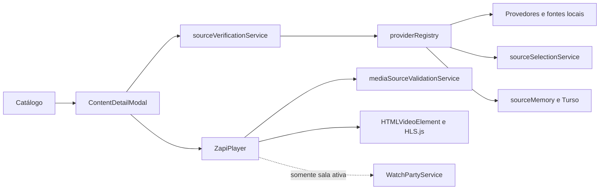

# Reprodução: arquitetura atual e diagnóstico

## Fluxo existente



O catálogo e a disponibilidade são módulos distintos (`src/core/catalog` e `src/core/providers`). `ContentDetailModal` inicia a descoberta e usa um identificador de requisição e `AbortController` para ignorar respostas antigas. `sourceVerificationService` faz até duas verificações e retorna `AVAILABLE`, `UNAVAILABLE` ou `INCONCLUSIVE`. Aqui, `AVAILABLE` significa **fonte candidata encontrada**, ainda não prova que houve reprodução. O `ZapiPlayer` prepara a fonte, controla a intro e confirma os eventos reais de vídeo. A Watch Party só entra no fluxo quando há sala conectada.

## Cache e falhas

`providerRegistry` usa cache positivo em memória por até 15 minutos e cache negativo por até 15 segundos. A chave inclui tipo de mídia, IDs, título, ano, temporada e episódio. A segunda verificação ignora o cache negativo. O histórico coletivo de fontes em Turso é uma prioridade adicional; a descoberta convencional permanece disponível.

Uma busca vazia só é conclusiva quando ao menos um provedor foi consultado e os provedores consultados terminaram sem erro. Timeout ou erro ainda pendente resulta em `INCONCLUSIVE`, preservando a distinção entre falha temporária e ausência confirmada. O registro diagnóstico fica em `sourceVerificationService.getLastDiagnosticLog()`; ele contém provedores, tempos e classificação, sem precisar registrar URL sensível.

## Como verificar

```powershell
npx vitest run tests/source_double_verification.test.ts tests/availability_and_dubbing_unification.test.ts tests/player_intro_and_readiness_order.test.ts tests/catalog_structural_isolation.test.ts
npm run build
npm run lint
```

`npm run lint` executa `tsc --noEmit`. No diagnóstico inicial desta etapa, o TypeScript já apresentava erros em `App.tsx` e `ContentDetailModal.tsx`; o build e os testes selecionados passavam. O build isolado não prova imagem ou áudio. Para uma mudança de provedor, acrescente testes determinísticos para identidade, episódio, erro e recuperação, depois valide a reprodução real em navegador e na implantação antes de considerá-la concluída.

## Limites atuais

`ZapiPlayer.tsx` ainda reúne preparação, intro, áudio, recuperação e interface. A separação em orquestrador e engine exige testes de comportamento antes de extrair código. `sourceVerificationService` identifica candidatos, mas a reprodução confirmada depende dos eventos do player. Fontes externas podem falhar por autorização, DRM, rede ou expiração; esses casos precisam ser observados separadamente da indisponibilidade do catálogo.
